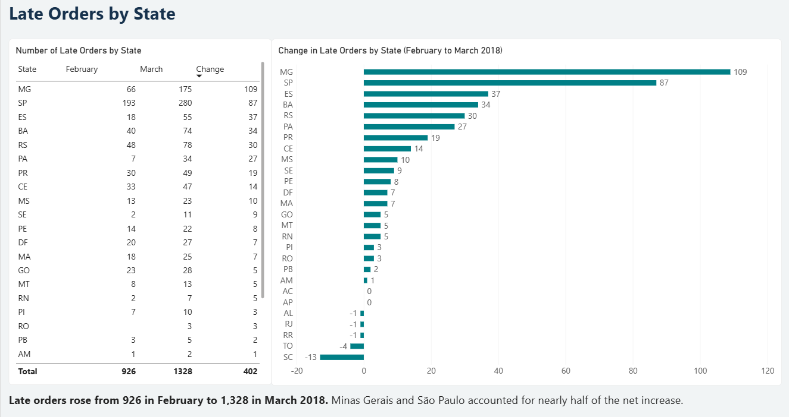
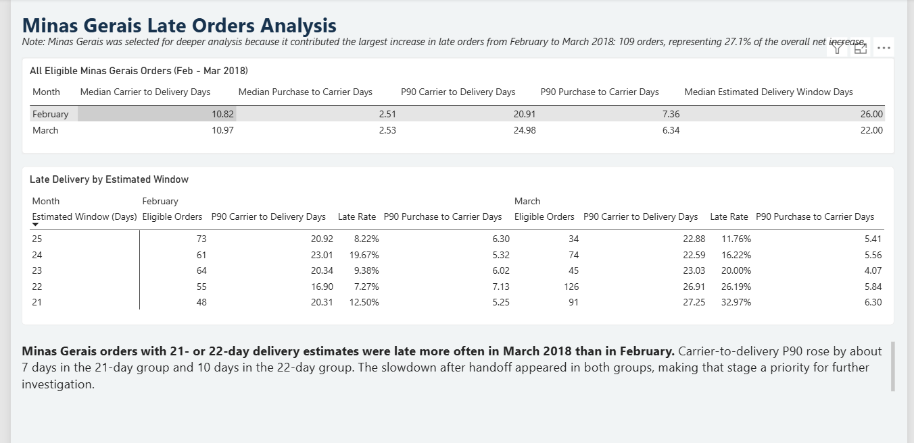

# Olist E-Commerce Analysis

This project uses the Olist dataset to analyze marketplace sales, delivery performance, and customer satisfaction.

**Project status**

| Area | Status |
| --- | --- |
| Delivery performance | Complete. Validated in Excel and documented in a three-page Power BI report. |
| Customer satisfaction | Next. Compare review scores for on-time and late deliveries. |
| Marketplace sales | Planned. Analyze monthly item sales and sales by product category. |

## Power BI Delivery Analysis

[Download the Power BI report](./Olist%20E-Commerce%20Analysis.pbix)

- **Delivery Overview:** Of 96,470 eligible delivered orders, 6,534 (6.77%) arrived late. March 2018 had the highest late rate among months with at least 100 eligible orders, at 18.96%.
- **Delivery Exploration:** Late orders rose from 926 in February to 1,328 in March 2018. Minas Gerais and São Paulo accounted for 196 of the 402 net additional late orders (48.8%).
- **Minas Gerais Deep Dive:** Minas Gerais was selected because it contributed the largest increase in late orders: 109, or 27.1% of the overall net increase. Orders with the same 21- or 22-day delivery estimate were late more often in March than in February. The 90th-percentile time from carrier handoff to delivery rose by about 7 days for the 21-day group and 10 days for the 22-day group. This points to post-handoff transit as a stage to investigate further.

## Delivery report screenshots

### Delivery Exploration

| State | February late orders | March late orders | Increase | Share of overall net increase |
| --- | ---: | ---: | ---: | ---: |
| Minas Gerais (MG) | 66 | 175 | 109 | 27.1% |
| São Paulo (SP) | 193 | 280 | 87 | 21.6% |
| **MG and SP combined** | **259** | **455** | **196** | **48.8%** |

The denominator for these contributions is the overall net increase of 402 late orders, including decreases in other states. MG was selected as a focused case study because it contributed the largest absolute increase. This does not establish that MG had the largest late-rate deterioration or that SP needs no further investigation; those conclusions require comparing eligible-order volumes and late rates.

### Minas Gerais Deep Dive

Across eligible MG orders, median carrier-to-delivery time was similar in February and March (10.82 versus 10.97 days), while P90 increased from 20.91 to 24.98 days. The median estimated delivery window shortened from 26 to 22 days.

Comparing orders within the same estimated delivery windows:

| Estimated window | February eligible orders | March eligible orders | February late rate | March late rate | February carrier-to-delivery P90 | March carrier-to-delivery P90 |
| --- | ---: | ---: | ---: | ---: | ---: | ---: |
| 21 days | 48 | 91 | 12.50% | 32.97% | 20.31 days | 27.25 days |
| 22 days | 55 | 126 | 7.27% | 26.19% | 16.90 days | 26.91 days |

Both groups had higher late rates and longer carrier-to-delivery P90 in March. These descriptive results identify post-handoff transit as a priority for investigation; they do not establish the cause of the delays.

The screenshots capture the latest report annotations. The downloadable PBIX remains the previously uploaded version until the latest saved report is provided.

## Excel Validation

Of the **96,470 delivered orders with a recorded actual delivery date and an estimated delivery date**, **6,534 (6.77%)** arrived after their estimated date. The remaining **89,936 (93.23%)** arrived on or before it.

| Delivery timing | Orders | Share of eligible orders |
| --- | ---: | ---: |
| Before the estimated date | 88,644 | 91.89% |
| On the estimated date | 1,292 | 1.34% |
| After the estimated date | 6,534 | 6.77% |
| **Total eligible** | **96,470** | **100.00%** |

[Download the original analysis workbook](https://raw.githubusercontent.com/iriskillah/olist-ecommerce-analysis/main/analysis/Orders%20dataset%20with%20analysis.xlsx). Start with the **Findings** and **Analysis** tabs, then see **Assumptions** and **Data Quality Notes** for the decisions behind the numbers.

## How I measured delivery timeliness

1. Checked the grain of the orders table. It contains 99,441 rows with unique, populated order IDs.
2. Limited the comparison to orders marked delivered with both actual and estimated delivery dates. Eight of 96,478 delivered orders lacked an actual delivery date and were excluded from the rate.
3. Subtracted the estimated calendar date from the actual calendar date. Delivery on the estimated date counts as on time. Estimated timestamps were recorded at midnight, so I used calendar dates as a project assumption.
4. Kept delivery eligibility separate from duration eligibility. A missing carrier date does not exclude an otherwise eligible order from the late rate, but it does exclude that order from carrier-to-delivery duration calculations.
5. Investigated the largest variances and retained the flagged records. Across the eligible orders, 52 (0.05%) arrived more than 90 days before or after the estimate.

## Next Analysis: Delivery Delays and Customer Reviews

**Question:** Were late orders more likely to receive a 1- or 2-star review?

1. Import `olist_order_reviews_dataset.csv` and check for missing or repeated `order_id` values. If an order has multiple review records, document how I choose one valid score before joining reviews to orders.
2. Compare on-time and late orders using the same delivery eligibility rules as the current report. For each group, show eligible orders, orders with a valid review, and review coverage.
3. Calculate the share of reviewed orders rated 1 or 2 stars in each group. Use review coverage to put the comparison in context.

## Data source

The Excel workbook uses the orders table. The Power BI report also uses the customers table to group orders by customer state. Both come from the [Brazilian E-Commerce Public Dataset by Olist](https://www.kaggle.com/datasets/olistbr/brazilian-ecommerce). The source dataset is licensed under [CC BY-NC-SA 4.0](https://creativecommons.org/licenses/by-nc-sa/4.0/).
